# janus

**A secure transport pair: an SMB client ↔ an arbitrary storage, with no Samba and no kext.**

The job of janus is to give any SMB client a local share on `127.0.0.1` and to redirect everything the
client writes into it to the chosen storage backend **over a secure channel**. SMB terminates
on loopback and never leaves the machine; only the backend transport goes onto the network (mTLS-gRPC or direct S3).
The client sees an ordinary local disk and the storage sees a controlled stream; our code sits between them.
The name: Janus, the two-faced god of doors: one face looks at the SMB client, the other at the storage.

**The first supported mode is macOS Time Machine** (`backupd` writes a sparsebundle into the local
share → janus carries it into the storage): this is the most demanding SMB client, and the Apple semantics
(AAPL, F_FULLFSYNC, durable handles V2, lease V2) that no open non-GPL SMB server has are
implemented specifically for it. But the model is wider than TM: the same transport layer serves
Windows and Linux clients (profiles below) and arbitrary backends (Features below). TM is a mode,
not the purpose of the project.

## Main modules

| Crate | What it is |
|---|---|
| `smb-wire` | the SMB2/3 codec: bytes ↔ types, crypto primitives, NTLMSSP. Zero I/O and no state |
| `smb-core` | the server core: connections, sessions, durable handles V2, lease V2, AAPL/F_FULLFSYNC |
| `janus-lib` | the client side: `StorageBackend` (storage backends), the sparsebundle model, the WAL journal, the uploader, the control plane |
| `janus-proto` | the protobuf contract (band transport + control plane), tonic/prost |
| `janus-smbd` | the SMB daemon binary (foreground `--dev` / launchd socket activation) |
| `janus-cli` | the CLI for managing the daemons: `janus-cli smbd …` and `janus-cli receiver …` |
| `janus-receiverd` | an optional receiving server (gRPC/mTLS → files) for your own storage |

**Topology.** The SMB server (`janus-smbd`) is always on the client side, on loopback. What stands behind
the share is determined by the **backend** (`StorageBackend`); there are several (see Features): the own
receiver `janus-receiverd`, a local folder, S3. Janus identifies the client by mTLS; the share host is
fixed (`127.0.0.1`), only the port and the share name vary (set through `configure`).

## Client compatibility (profiles)

The profile is set per share (`Configure.profile`); the core branches only on capabilities
(`CompatCaps`), not on "platforms". Invariants for all: dialect **3.1.1 only**
(this removes FSCTL_VALIDATE_NEGOTIATE_INFO), **signing is mandatory**, NTLM with no guest access.

| Profile | Client | Specifics | Status |
|---|---|---|---|
| `TIME_MACHINE` | macOS `backupd` | case-sensitive, AAPL, F_FULLFSYNC, durable V2 + lease V2 | **first target** |
| `WINDOWS_GENERIC` | Explorer / robocopy / wbadmin / File History | case-insensitive lookup, no AAPL, "empty" replies to ADS/SD probes | roadmap |
| `POSIX_GENERIC` | Linux `cifs.ko` / smbclient | case-sensitive, SMB 3.1.1 POSIX extensions (optional), symlinks | roadmap |

Server platforms: macOS (loopback topology), Linux/FreeBSD. Windows as a server is not a target
(445 is taken by the system LanmanServer).

## Features (storage backends)

What stands behind the SMB share is a choice of implementation of the `StorageBackend` trait in `janus-lib`. The backends
are enabled by cargo features so that the main build does not pull in unneeded dependencies.

| Feature | Backend | Where it writes | Status |
|---|---|---|---|
| `backend-local` | `LocalFsBackend` | a local folder | dev/tests |
| `backend-grpc` | `GrpcBackend` | the own `janus-receiverd` over gRPC/mTLS | write-ahead journal + background upload (J3b, default); sync-through with `--journal off` |
| `backend-s3` | `S3Backend` | **any S3-compatible bucket** (AWS S3, MinIO, R2, B2, Wasabi, Ceph) | planned |

### `backend-s3`: direct upload to S3 (planned)

The final consumer is **any S3 bucket**, and `janus-receiverd` is not needed: `janus-smbd`
is itself the bucket's client. It is built on the official `aws-sdk-s3` (async/tokio, works with
any S3-compatible endpoint via `endpoint_url`; Apache-2.0/MIT license).

Architecturally it fits in without rework: `S3Backend` is one more implementation of the same `StorageBackend`
trait, next to the gRPC and local backends. The non-trivial part is the **write semantics**:
SMB issues offset writes into band files, while an S3 object is atomic (no partial overwrite). Our
WAL journal and uploader (already designed) cover this: offset writes accumulate in the journal,
and the uploader uploads bands/chunks as objects in batches (`PutObject`/multipart). The mapping fork
"band = object / chunk = object" is an open question in the S3 backend design.

## Build

```
cargo build --workspace     # protoc is NOT needed: janus-proto pulls protoc-bin-vendored
cargo test  --workspace
```

The toolchain is pinned in `rust-toolchain.toml`. CI (GitHub Actions, `.github/workflows/ci.yml`):
fmt + clippy (`-D warnings`) on Linux, build+test on Linux and Windows.

**Dev run:**
```
janus-smbd --dev                       # a foreground SMB server on 127.0.0.1
janus-cli smbd configure --endpoint … --client-cert … --client-key … --ca … [--port N] [--share NAME]
```

## Implementation status

J1 is done: SMB 3.1.1 (the only dialect, signing mandatory), NEGOTIATE with preauth
integrity, SESSION_SETUP over SPNEGO/NTLMv2, TREE_CONNECT/TREE_DISCONNECT/LOGOFF/ECHO,
credits. J2 is done: the file model (CREATE, CLOSE, READ, WRITE, FLUSH, QUERY_INFO,
QUERY_DIRECTORY, SET_INFO) over `StorageBackend`, with `LocalFsBackend` as the first backend; a
real macOS client (`mount_smbfs`) mounts the share, copies files both ways and the hashes
match (details and the run are in `crates/smb-core/README.md`). J3 is done: `GrpcBackend` over mTLS,
the write-ahead journal with background upload, interim STATUS_PENDING for slow operations.
J4 is implemented: Time Machine (`backupd`) completes a backup through the share (AAPL, durable and
lease V2, `F_FULLFSYNC`, Bonjour); see `crates/smb-core/README.md` and the lab scripts in `tools/lab/`.
Business logic marked `todo!()` (S3 backend, launchd socket activation, event broadcast) is tied to the
architecture sections below.

## License

MIT. See [LICENSE](LICENSE).

---

# Architecture (how the modules are built)

> The detailed structure of every module: types, state tables, state machines, flows.
> UML is in Mermaid (classDiagram / stateDiagram / sequenceDiagram). The status is a design model;
> type boundaries may shift after the PoC (the `backupd` trace, the audit of the `smb-rs` donor).


## Layer 2: SMB termination (`smb-wire` + `smb-core`)

The watershed between the two crates: **`smb-wire` is bytes ↔ types, zero I/O,
zero long-lived state; `smb-core` is all protocol state and I/O.** If a type describes
"what is in the packet", it is in wire; if "what we remember between packets", it is in core.

### 2.1. `smb-wire`: the codec

> **Why the types say "SMB2" when we need SMB3:** "SMB3" is not a separate protocol but the later
> **dialects** of the SMB2 protocol (0x0300/0x0302/0x0311), negotiated in NEGOTIATE; the frame format and
> the command set are the same SMB2 (the MS spec is itself titled *"[MS-SMB2]: … Versions 2 and 3"*,
> and the Apple extension is "SMB2 FLUSH with Reserved1=0xFFFF"). The "threeness" lives not in structures
> but in the plumbing: preauth SHA-512, SP800-108 keys, AES-CMAC signing, the encryption transform header,
> which for us is `crypto` + `ConnState.dialect(3.1.1)`. A separate protocol is only the legacy SMB1/CIFS
> (a different frame format), which we do not implement at all.

**Responsibilities:** parsing/serialization of SMB2 frames and all structures, crypto primitives
(signature/hash/key derivation) as pure functions, NTLMSSP/SPNEGO tokens.
**NOT responsibilities:** sockets, tokio, session tables, timers, decisions of "what to answer".

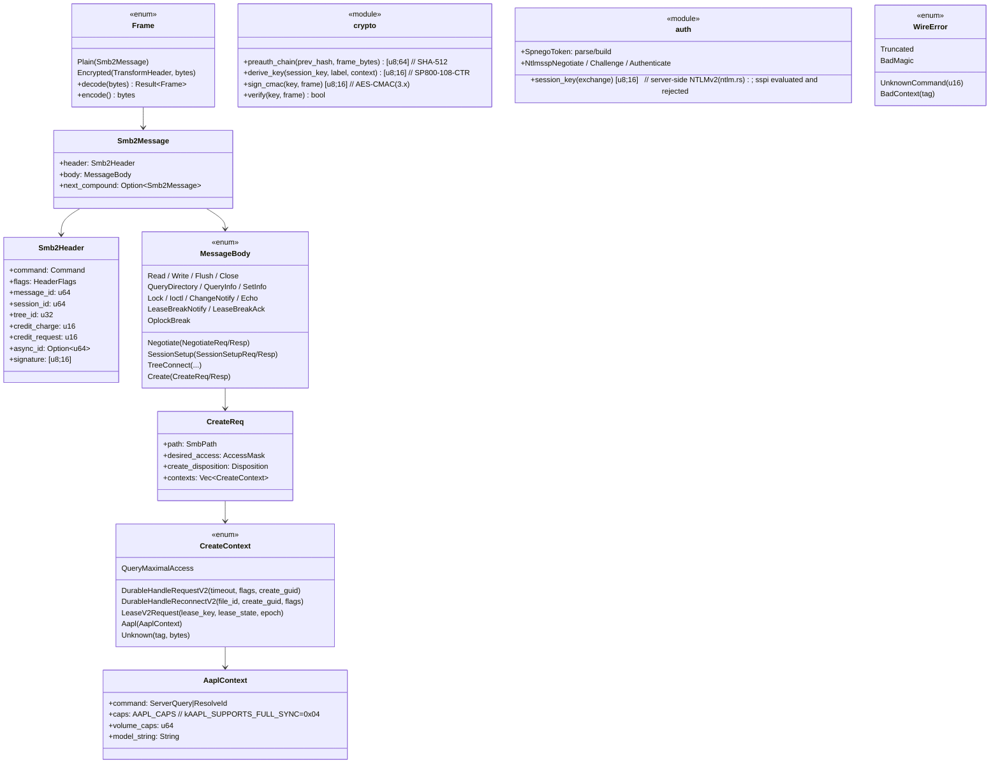

**Key decisions:**
- `Frame::decode` is **total**: any byte input gives `Ok` or a typed `WireError`,
  a panic is unacceptable (fuzzing is a mandatory CI stage of this crate; the corpus is the backupd trace from the PoC).
- `CreateContext::Unknown(tag, bytes)`: unknown contexts are **preserved and pass through**,
  not dropped: the Apple client sends contexts that are absent from MS-SMB2, and CREATE must not fail.
- A compound chain (`next_compound`) is parsed in wire (that is the format) and executed in core
  (that is the related/unrelated semantics).
- `crypto`/`auth` are pure functions over bytes; state (which hash is accumulated, which NTLM leg) is in core.
- If the `smb-rs` donor is confirmed: the `Smb2Header`/`MessageBody` structures are candidates to be replaced
  by the `smb-msg`/`smb-dtyp`/`smb-fscc` types; the server-side Create contexts (the durable/lease/AAPL
  **response** side) we will almost certainly write ourselves.

---

### 2.2. `smb-core`: structure (actors and tables)

The execution model is **tokio, an actor per TCP connection** + shared tables. Everything that has to
outlive a connection (durable handles, leases, sessions) lives NOT in the actor but in the
`ServerShared` tables; the actor holds only the link and per-connection state.

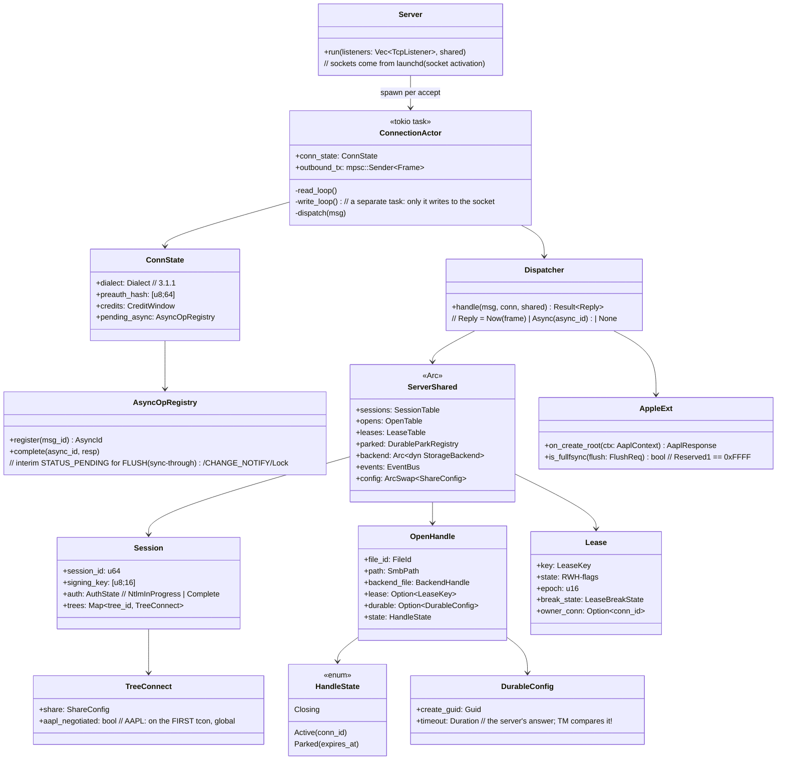

**Key decisions:**
- **`write_loop` is the single writer to the socket** (an mpsc queue). This is the mechanics of
  server-initiated send: a lease break is put into the same queue from anywhere
  (`LeaseTable::request_break`), without waiting for the request/response cycle.
- **`OpenTable`/`LeaseTable`/`DurableParkRegistry` are outside the actor** (in `ServerShared`): the death of a
  connection kills the actor but NOT the handle, which moves `Active → Parked(expires_at)` with a timer.
  This is a direct embodiment of the requirement "durable survives TCP".
- **Credits** (`CreditWindow`) are per-connection and granted in every reply; an interim reply
  (STATUS_PENDING) carries credits too, otherwise the client chokes on a long FLUSH.
- `ArcSwap<ShareConfig>`: hot config change on `Configure`/`RotateCredentials` without
  restarting connections.
- `Dispatcher` is a pure function of `(msg, state)`: the whole transition table is tested without
  sockets (unit level), and sockets exist only in the actor.

---

### 2.3. State machines (UML statecharts)

**Connection (per TCP):**
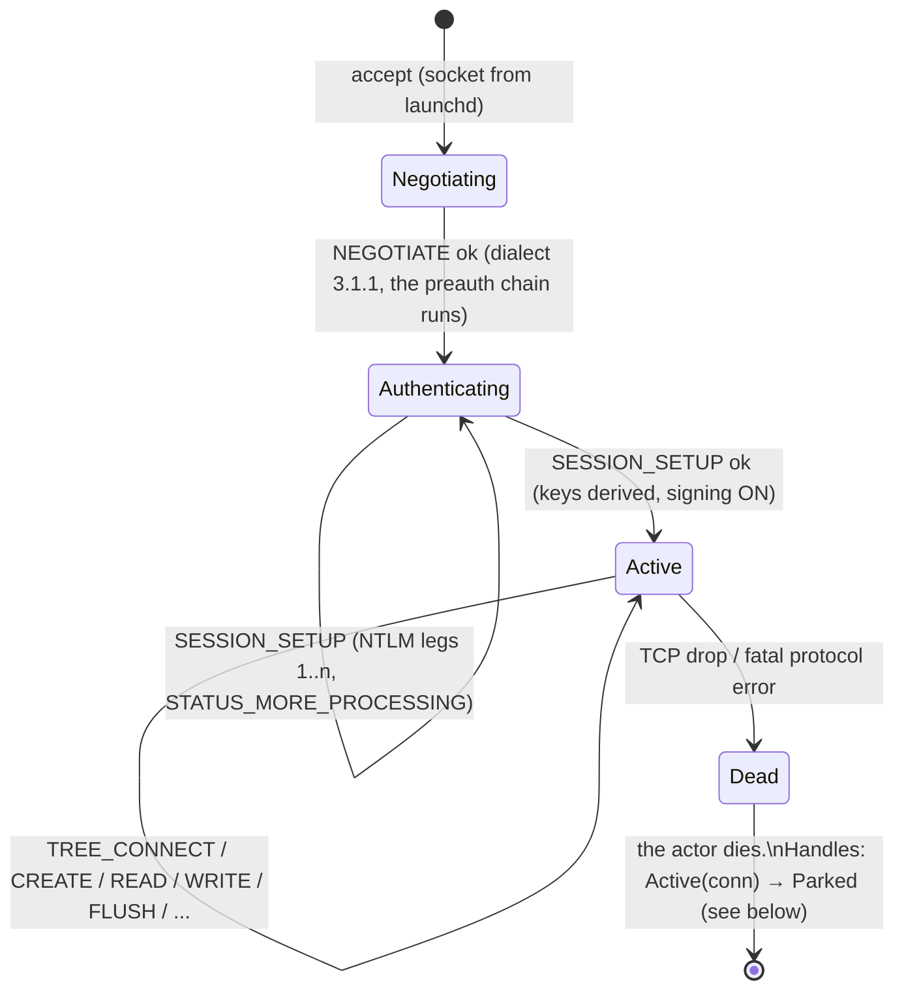

**Open handle (durable V2): the heart of the Apple semantics:**
```mermaid
stateDiagram-v2
    [*] --> Opening : CREATE + DurableHandleRequestV2
    Opening --> Active : backend open ok\n(the reply Timeout is recorded; TM will compare it)
    Active --> Parked : TCP drop of the owning connection\n(timer = DurableConfig.timeout)
    Parked --> Active : CREATE + DurableHandleReconnectV2\n(create_guid matched, new conn_id)
    Parked --> Expired : the timer expired
    Active --> Closed : SMB2 CLOSE
    Expired --> [*] : backend close, lease released\n(TM will handle the failed pass itself)
    Closed --> [*]
```

**Lease V2 (with a server-initiated break):**
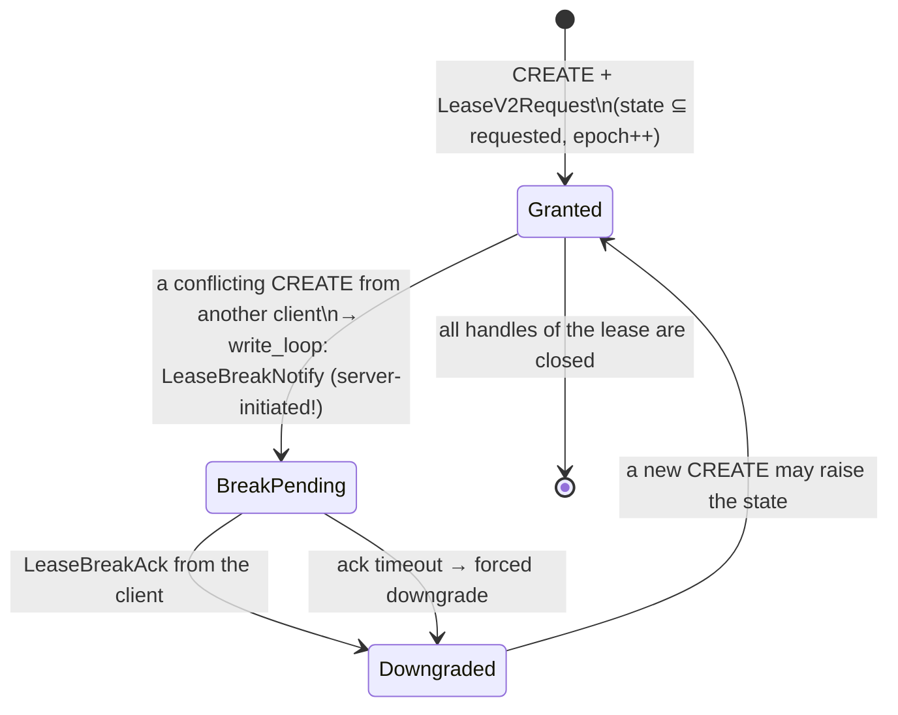
> Note on scale: we have one client (backupd) and one share, so conflicting opens are rare
> (a second mount, Finder browsing). But the break path must work: validation may trigger it,
> and the spec requires correctness unconditionally.

---

### 2.4. Key scenarios (sequence)

**Durable reconnect after a drop (the junction with the Layer 1 journal):**
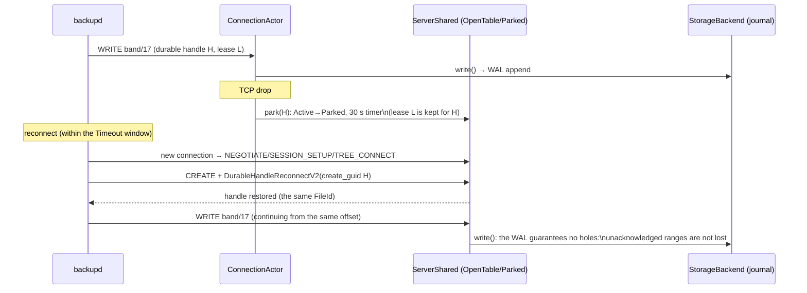

**F_FULLFSYNC under sync-through (why AsyncOpRegistry):**
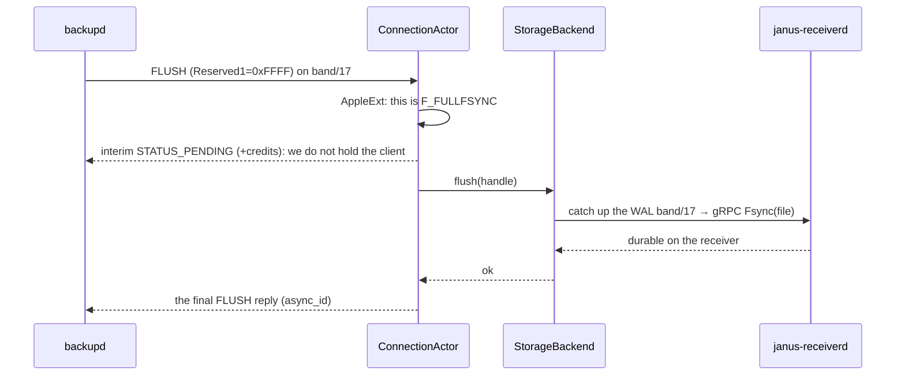

---

### 2.5. Open design questions of the layer (resolved by the PoC/audit)

- ❓ **Donor boundaries:** how much of §2.1 is really covered by `smb-msg`/`smb-dtyp`/`smb-fscc`
  (especially the response side of Create contexts): the `smb-rs` audit.
- ❓ **Preauth hash and signature on compound chains:** the exact semantics per MS-SMB2 (which bytes
  go into the hash for a related compound): check against the trace.
- ❓ **One write_loop vs priority queues:** whether LeaseBreakNotify/interim needs a separate priority
  ahead of bulky READ replies (loopback is fast, so perhaps not).
- ❓ **Where the lease lives for a Parked handle:** the spec permits keeping a lease for a disconnected
  durable handle: confirm backupd's behaviour (affects `Lease.owner_conn`).
- ❓ **CHANGE_NOTIFY:** whether backupd sends it at all (trace); if it does, `AsyncOpRegistry`
  is extended with a subscription to `sparsebundle-model` events.

---

## Layer 1: storage (`janus-lib`: vfs / sparsebundle-model / journal / uploader)

The job of the layer: turn the stream of SMB operations from Layer 2 into reliably delivered band files on
the appliance, answering fast (WAL) and not depending on instant availability of the network. Both
durability policies and the Drain barrier live here.

### 1.1. `vfs`: the StorageBackend trait (the layer boundary)

The only door through which `smb-core` sees storage. An async trait, two implementations.

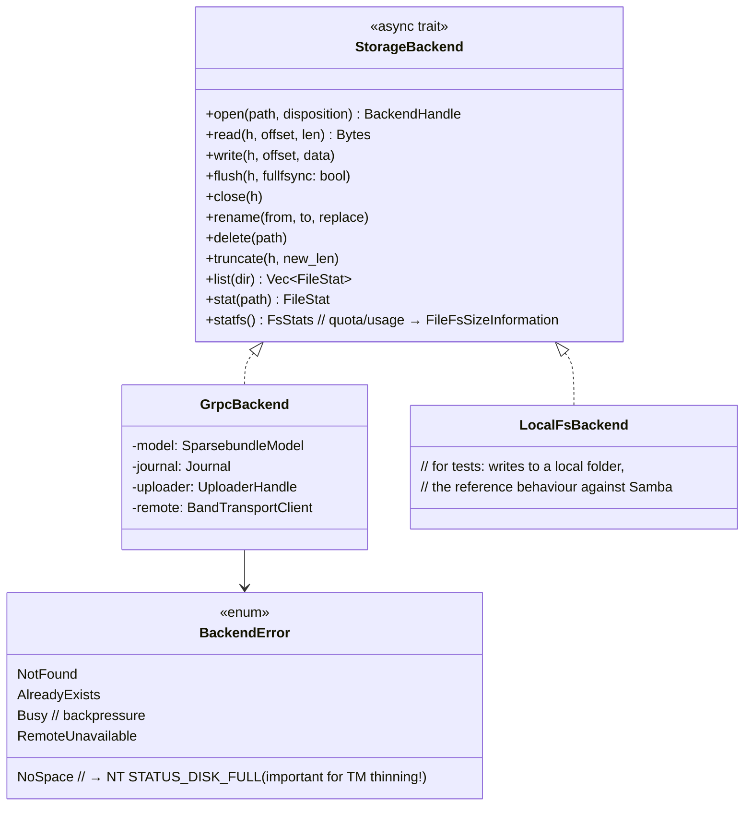

- **Error mapping is part of the contract:** `smb-core` translates `BackendError` into NTSTATUS.
  Critical: `NoSpace → STATUS_DISK_FULL` is the signal on which TM starts thinning;
  lying here means TM will not clean up old points.
- `flush(h, fullfsync)`: the flag is forwarded from `AppleExt::is_fullfsync`; a plain FLUSH and
  F_FULLFSYNC may have different costs (see §1.3).

### 1.2. `sparsebundle-model`: path classification and per-type policy

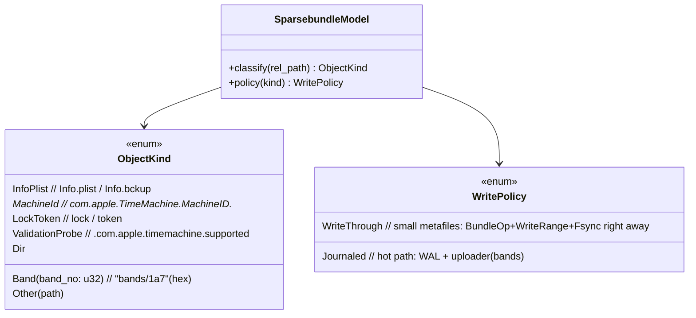

- **Bands** are 99% of the traffic, fixed-size offset writes → `Journaled`.
- **Metafiles** (`Info.plist`, MachineID, lock/token) are small and rare, but their integrity is
  critical for the validity of the bundle → `WriteThrough` (synchronously up to the appliance): it simplifies
  reasoning, and the cost is negligible.
- `ValidationProbe` is the validation-handshake file: an ordinary `WriteThrough`, nothing special,
  but useful as a marker in events (`validation_passed`).

### 1.3. `journal`: the WAL (the point of local durability)

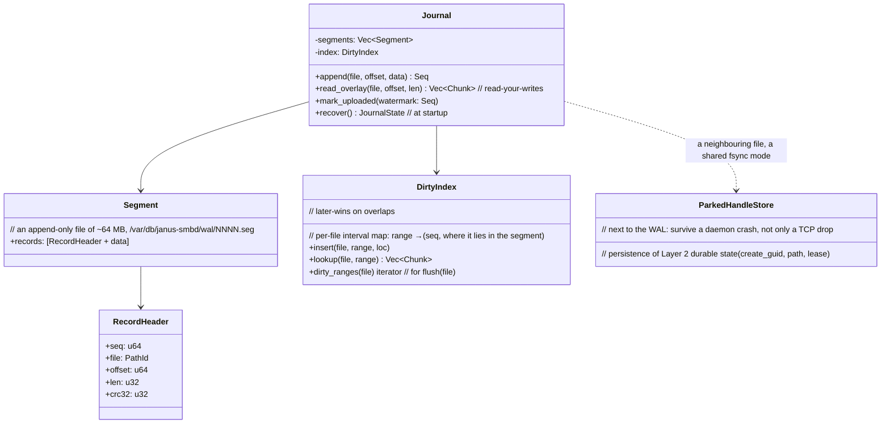

**Decisions:**
- **`read_overlay` is mandatory:** READ must see not-yet-uploaded writes
  (read-your-writes). The answer to a READ is a merge: ranges from the WAL (fresh) on top of data from
  the appliance (`ReadRange`). Otherwise backupd would read old bytes and decide the image is corrupt.
- **Later-wins in `DirtyIndex`:** overlapping writes collapse even before upload,
  so reordering on the network is safe, because already non-overlapping ranges are sent.
- **The segment fsync mode depends on the policy (§8.2):** LOCAL_JOURNAL: the WAL fsync is the answer
  to F_FULLFSYNC (the durability point on the Mac); SYNC_THROUGH: the WAL may be fsynced lazily
  (the durability point is on the receiver), and the WAL is then only transit+overlay.
- **Recovery at startup:** scan segments from the last checkpoint, restore
  `DirtyIndex` + `ParkedHandleStore` → after a crash the daemon continues from the same place, and durable
  handles survive not only a TCP drop but also our restart.
- **A size limit → `Busy`** upward (Layer 2 slows down WRITE replies: backpressure on backupd,
  which TM tolerates normally, just slower).

### 1.4. `uploader`: delivery to the appliance

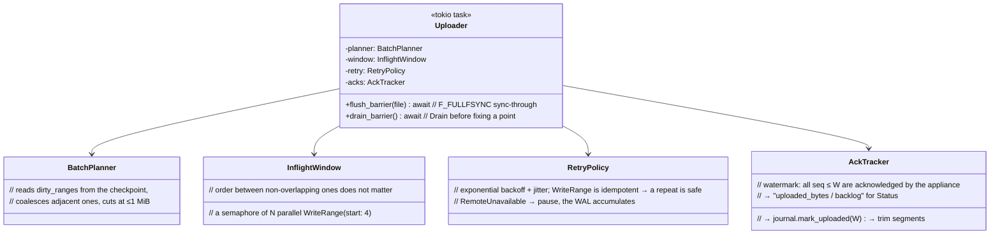

**Barriers are the only synchronization points:**
- `flush_barrier(file)`: wait for the acks of all dirty ranges of the file → `Fsync(file)` on the
  receiver → return control (an honest F_FULLFSYNC under SYNC_THROUGH stands on this);
- `drain_barrier()`: the same for the whole bundle + `Fsync(all_bundle)` (`Drain` stands on this
  before fixing a point);
- outside the barriers the uploader is fully asynchronous and does not affect SMB reply latency.

### 1.5. End-to-end scenario: WRITE → READ of the same range → FLUSH

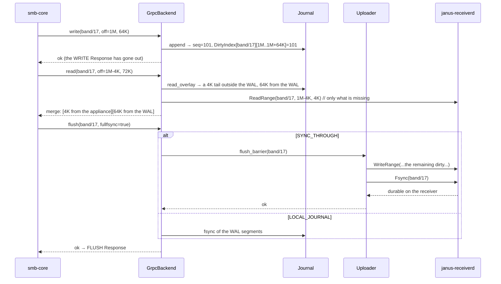

### 1.6. Open questions of the layer

- ❓ **Placement WAL:** `/var/db/janus-smbd/` (root-only) vs `/Library/Application Support/…`;
  the limit size (a first estimate is 2–8 GB, configurable) and behaviour on small disks.
- ❓ **The group-commit interval** of the WAL fsync under LOCAL_JOURNAL (F_FULLFSYNC latency vs SSD wear).
- ❓ **WriteThrough for metafiles when the appliance is unavailable:** refuse at once (honest) or
  journal and degrade to Journaled (harder, but more resilient)? We lean towards "refuse":
  without the appliance the backup does not run anyway.
- ❓ **Reads while browsing points** (the user walks through history): a ReadRange cache on the Mac is
  a separate decision after the PoC and does not change the contract.
- ❓ **PathId interning** in the WAL (there are thousands of band paths, a string in every record is wasteful).

---

## Layer 3: management (control / config / bonjour / observability)

A layer without "clever" logic of its own: a facade over Layers 1–2 for the agent. The main principle is
**nothing in this layer is on the hot path** (WRITE/READ do not see it; the exception is
a single atomic `WriteGate` check).

### 3.1. `control` + `config`: the agent service and the configuration

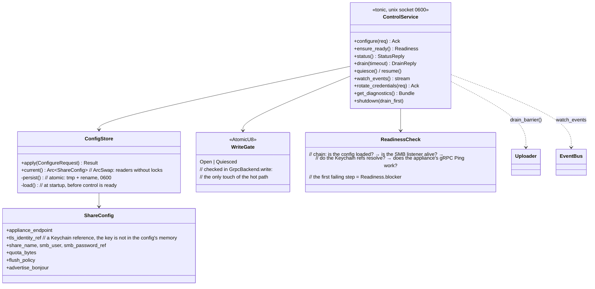

**Decisions:**
- **`Configure` is the only writer of the config**; applying = validation → persist →
  `ArcSwap` → rebuilding dependents (a gRPC channel reconnect, a Bonjour re-advert). SMB sessions
  are NOT torn down on a config change (except a change of SMB credentials, which makes new SESSION_SETUPs use the new ones).
- **`Quiesce` = `WriteGate::Quiesced`**: `GrpcBackend.write` answers with a delay/retry
  (backpressure), sessions stay alive. There are no other gates in the layer.
- **`Drain` is just a pass-through** to `Uploader::drain_barrier(timeout)` (§1.4); control does not know
  what a "band" is.
- `ReadinessCheck` is an ordered chain with the first failing step in `blocker`: the agent
  gets not "not ready" but "what exactly to fix".

### 3.2. `bonjour`: the mDNS advertisement

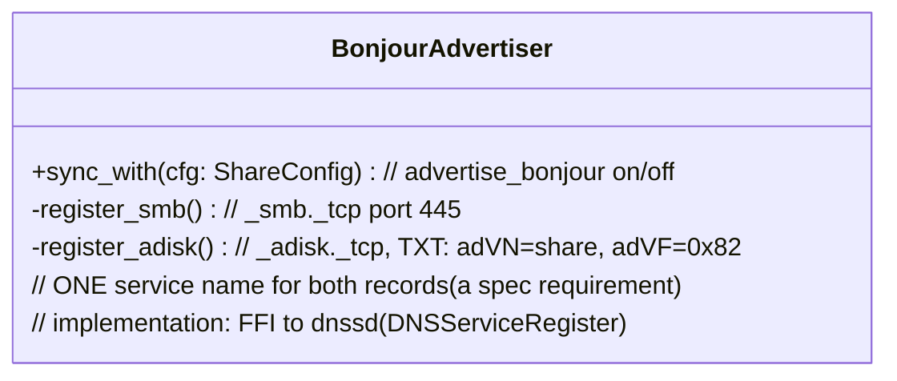
A trivial wrapper module; all the complexity is the question of "whether it is needed at all" (a PoC knot).
The registration is made on behalf of this same Mac (we advertise ourselves).

### 3.3. `observability`

```mermaid
classDiagram
    direction LR
    class Metrics {
        <<atomics, lock-free>>
        smb_sessions, open_handles, parked
        journal_backlog_bytes, uploaded_total
        upload_errors, last_ack_ms
        +snapshot() StatusReply
    }
    class EventBus {
        <<tokio broadcast>>
        +emit(Event)
        // subscribers: the agent's WatchEvents streams + DiagRing
    }
    class DiagRing {
        // a ring buffer of the last N events/errors
    }
    class DiagnosticsCollector {
        +bundle() tar.gz  // DiagRing + a log tail + a metrics snapshot
        // + the config WITH SECRETS REDACTED (refs are not secrets anyway,
        //   but password values are never logged anywhere, by design)
    }
    Metrics <.. DiagnosticsCollector
    EventBus --> DiagRing
    DiagRing <.. DiagnosticsCollector
```
- All counters are atomics, and `Status` only reads them (the promise that "Status
  never slows down the hot path" is kept by construction).
- Layers 1–2 write to `Metrics`/`EventBus` directly (injected at assembly) and know nothing about control.

---

## Layer 4: the process (the `janus-smbd` binary)

Only glue, zero logic:

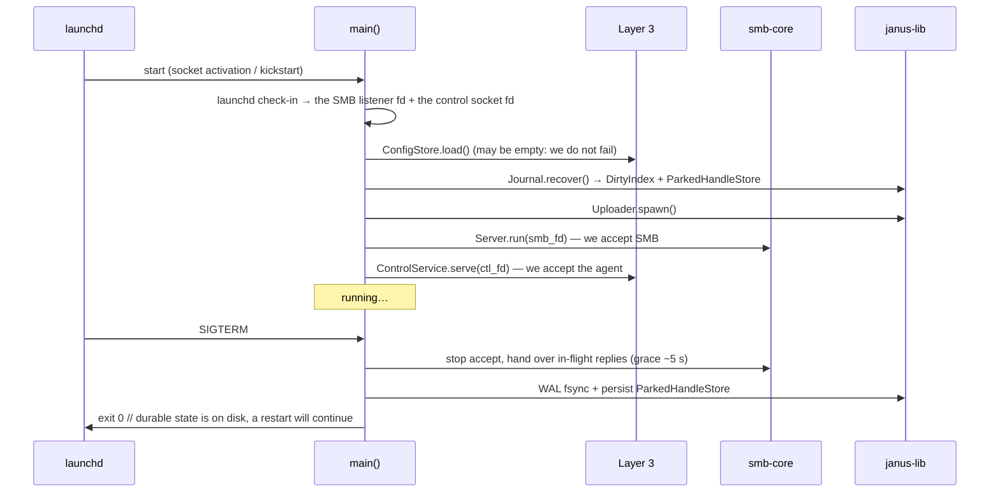

- **Panic policy: process-abort, not catch.** Integrity is provided by WAL recovery, not by
  catching panics: we crashed → launchd brought us up → `Journal.recover()`. A half-broken state in a live
  process is more dangerous than a restart.
- Graceful shutdown does NOT Drain by default (that is the agent's `Shutdown(drain_first)` command),
  it only fixes the durable state.

---

## janus-receiverd (the appliance, Linux/FreeBSD)

### R.1. Structure: router / worker (the rsync-proxy pattern)

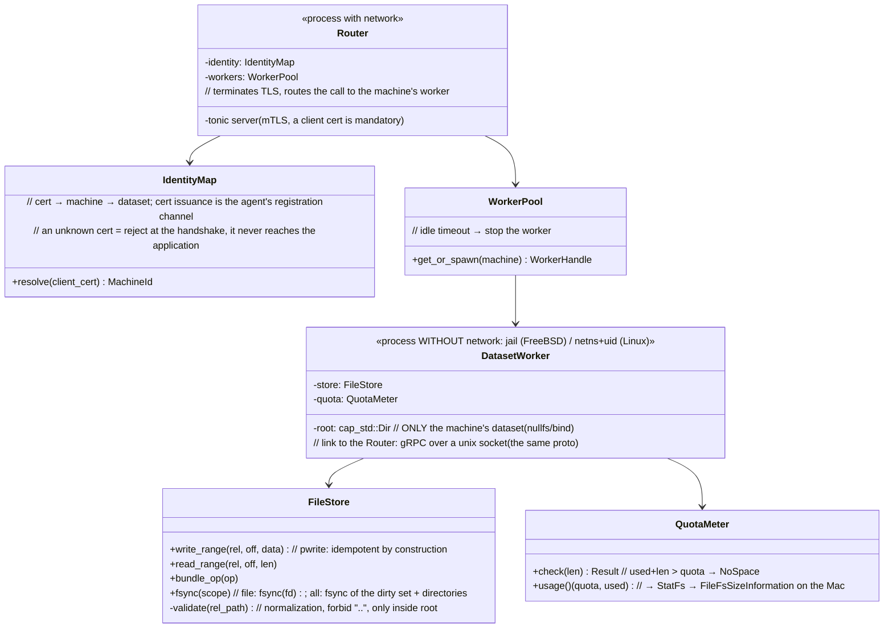

**Decisions:**
- **Double path protection:** dataset authorization is at the process level (the worker physically sees
  only its own dataset via nullfs/bind + `cap_std::Dir`), `rel_path` validation is the second line.
  Even a bug in validation does not let anything out of the dataset.
- **Workers are disposable and cheap:** spawned on a machine's first call, stopped when idle:
  exactly the lifecycle of jails in `rsync-proxy`.
- **`QuotaMeter` is the source of `NoSpace`**, which travels through `BandTransport → GrpcBackend →
  STATUS_DISK_FULL` to TM and starts thinning. The end-to-end chain is designed
  explicitly (see §1.1).
- Router and worker speak **the same `janus-proto`** over a unix socket: one contract,
  no second internal protocol.

### R.2. End-to-end path of a single WriteRange

```mermaid
sequenceDiagram
    participant SM as janus-smbd (Mac)
    participant RT as Router (appliance, network)
    participant WK as DatasetWorker (no network)
    participant FS as store

    SM->>RT: gRPC WriteRange (mTLS, the cert of machine M)
    RT->>RT: IdentityMap: cert → machine M → worker M
    RT->>WK: the same WriteRange over the unix socket
    WK->>WK: validate(rel_path), QuotaMeter.check
    WK->>FS: pwrite(bands/17, off, data)
    WK-->>RT: ok
    RT-->>SM: ok
    Note over SM,FS: Fsync(scope) goes along the same route;<br/>snapshots are OUTSIDE the receiver (the agent↔appliance channel)
```

### R.3. Open questions

- ❓ **Linux isolation:** the minimal sufficient set (uid + mount-ns + no-net-ns?):
  align it with the actual platform of the production appliance.
- ❓ **`QuotaMeter.usage`:** a query to the backend (exact, but costly per call) vs accounting in the worker
  (fast, drifts): probably a hybrid with periodic reconciliation.
- ❓ **Fsync(all_bundle):** tracking the dirty set in the worker vs a `syncfs` analogue on the dataset:
  measure the cost on a real pool.

---

*All layers are described. Further detail will follow the PoC (the backupd trace) and the `smb-rs` audit.*
